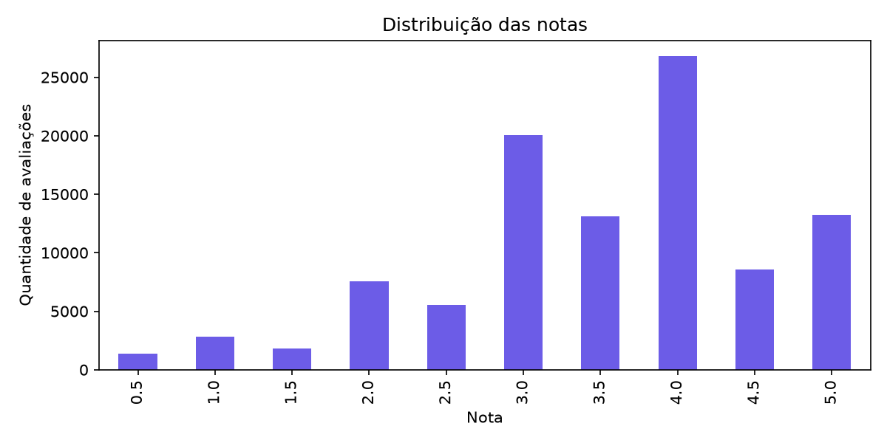
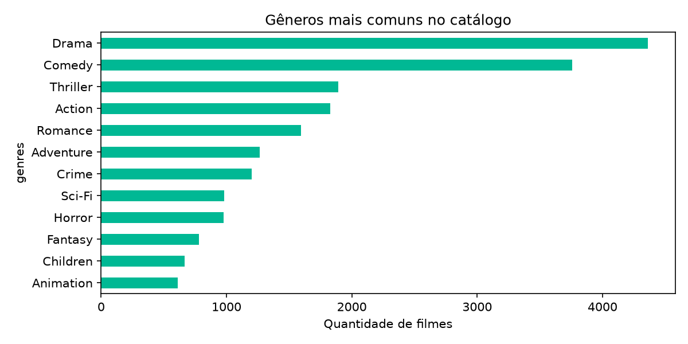
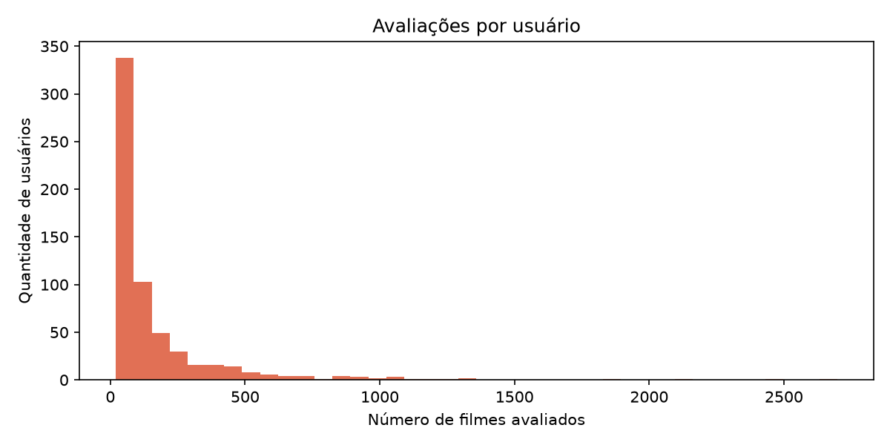
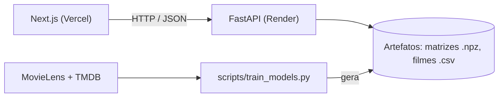

# CineMatch


**Recomendador de filmes que mostra _por que_ cada sugestão combina com você.**

**🔗 Demo ao vivo:** [https://cinematch-opal-eight.vercel.app](https://cinematch-opal-eight.vercel.app)

**📖 Documentação da API:** [https://cinematch-api-ytdg.onrender.com/docs](https://cinematch-api-ytdg.onrender.com/docs)

> ⏳ A API roda no plano gratuito do Render e "dorme" após 15 minutos sem uso.
> Na primeira visita, a resposta pode levar cerca de 1 minuto para acordar.


## O que é

O CineMatch recebe até 5 filmes que você ama e devolve recomendações personalizadas. Cada sugestão vem com uma explicação em linguagem natural ("Porque você gostou de Inception: mesmo diretor, gêneros em comum...") e você controla o quanto quer de **filmes parecidos** ou de **surpresas**.

O projeto nasceu de uma pergunta simples: _um sistema de recomendação consegue explicar o que faz, e ainda acertar?_ O repositório cobre o caminho completo: exploração dos dados, três modelos comparados com métricas, API, interface, testes e deploy.

## Funcionalidades

- **Busca com autocomplete**: ignora acentos e maiúsculas, aceita as palavras em qualquer ordem e começo de palavra.
- **Recomendações com explicação**: selo "Porque você gostou de..." e um detalhe completo em "Ver por quê".
- **Slider "mais parecido ↔ mais surpreendente"**: controla o peso entre o modelo de conteúdo e o colaborativo.
- **Filtros**: gênero (qualquer um dos escolhidos), década e nota mínima.
- **Listas "Quero assistir" e "Já vi"**, com nota de 1 a 5 estrelas, guardadas no navegador.
- **Perfil de gosto**: gráficos de gêneros e décadas que você curtiu, calculados a partir das suas notas.
- **Recomendar a partir das minhas avaliações**: usa os filmes avaliados com 4★ ou mais e nunca repete um filme já visto.
- **Estados de interface tratados**: carregamento (skeleton), erro, lista vazia e filtros sem resultado.

## Como funciona

### Dados

- **[MovieLens](https://grouplens.org/datasets/movielens/) `ml-latest-small`**: 100.836 avaliações de 610 usuários sobre 9.742 filmes (9.724 têm ao menos uma avaliação).
- **[TMDB](https://www.themoviedb.org/)**: sinopse, diretor, elenco, palavras-chave, nota e pôster, buscados por script e salvos em cache.

A matriz usuário × filme tem **98,30% de esparsidade**, ou seja, quase tudo é vazio. A nota mais frequente é 4, e os gêneros mais comuns são Drama, Comédia e Thriller.

| Notas | Gêneros | Avaliações por usuário |
|---|---|---|
|  |  |  |

### Os três modelos

1. **Conteúdo**: TF-IDF sobre dois blocos de texto, com pesos separados. O primeiro reúne gêneros, diretor, elenco e palavras-chave (nomes viram um único token, como `christophernolan`), e o segundo usa a sinopse. A similaridade é o cosseno.
2. **Colaborativo item-item**: dois filmes são parecidos se as mesmas pessoas os avaliaram de forma parecida. As notas são **centralizadas pela média de cada usuário** antes do cálculo, para que "gostou mais do que o normal para ele" valha igual para quem dá 5 em tudo e para quem raramente passa de 3.
3. **Híbrido**: `score = α · conteúdo + (1 − α) · colaborativo`, com os dois scores padronizados (z-score) para ficarem na mesma escala. O app usa **α = 0,4**.

Para recomendar a partir de uma lista de filmes, o perfil de gosto é a **soma dos vetores** dos favoritos. Filmes com menos de 20 avaliações não são recomendados, porque similaridades baseadas em poucos votos são enganosas.

### Explicações

Para cada filme recomendado, o sistema calcula quanto **cada favorito contribuiu** para o score e cita até dois deles. Os detalhes (mesmo diretor, elenco em comum, gêneros em comum) são comparados **com cada favorito citado, separadamente**. Uma versão anterior atribuía o elenco de um favorito a outro, e o erro virou um teste de regressão.

## Resultados

**Avaliação offline:** 20% das avaliações de cada usuário foram separadas para teste (divisão aleatória, `random_state=42`), e os modelos foram treinados só com os 80% restantes. Um filme é "relevante" se recebeu nota ≥ 4 no teste. As métricas medem o top-10 de cada usuário, sem filmes já vistos no treino.

**Mínimo de 20 avaliações por filme:**

| Modelo | Precision@10 | Recall@10 | Cobertura |
|---|---|---|---|
| Popularidade (baseline) | 0,1227 | 0,1079 | 0,58% |
| Colaborativo item-item | 0,1028 | 0,0995 | 6,46% |
| Conteúdo v2 | 0,0726 | 0,0580 | 6,11% |
| Híbrido (α = 0,2) | **0,1368** | **0,1217** | 6,40% |
| **Híbrido (α = 0,4)** | 0,1342 | 0,1181 | 6,12% |
| Híbrido (α = 0,6) | 0,1128 | 0,0918 | 6,05% |
| Híbrido (α = 0,8) | 0,0909 | 0,0732 | 6,09% |

**Mínimo de 50 avaliações por filme:**

| Modelo | Precision@10 | Recall@10 | Cobertura |
|---|---|---|---|
| Popularidade (baseline) | 0,1234 | 0,1086 | 0,58% |
| Colaborativo item-item | 0,1345 | 0,1137 | 3,07% |
| Conteúdo v2 | 0,1119 | 0,0821 | 2,98% |
| Híbrido (α = 0,2) | 0,1624 | 0,1320 | 3,01% |
| **Híbrido (α = 0,4)** | **0,1670** | **0,1366** | 2,89% |
| Híbrido (α = 0,6) | 0,1481 | 0,1163 | 2,87% |
| Híbrido (α = 0,8) | 0,1297 | 0,0987 | 2,92% |

### O que os números dizem

- **O híbrido venceu todos os modelos individuais.** Com α = 0,4, ele acerta cerca de 9% mais que o baseline de popularidade com o filtro de 20 avaliações e cerca de 35% mais com o filtro de 50.
- **O modelo de conteúdo sozinho foi o mais fraco**, abaixo até do baseline. Mesmo assim, ele melhora o híbrido, porque erra em lugares diferentes do colaborativo.
- **A popularidade é um baseline difícil de bater** neste dataset pequeno: ela recomenda os mesmos ~56 filmes para todo mundo (cobertura de 0,58%), mas a maioria dos usuários avaliou justamente os filmes populares.
- **Há um trade-off entre acerto e variedade.** Filtrar filmes com poucas avaliações aumenta a Precision e reduz a cobertura do catálogo.
- Os valores absolutos de Precision são baixos, como é normal em recomendação, porque cada usuário avaliou só uma pequena fração dos filmes.

### Conteúdo v1 vs. v2

Para _The Dark Knight_, a v1 (só gêneros e tags) sugeriu filmes como _Zelig_, _Now, Voyager_ e _Garden State_. A v2 (diretor, elenco, palavras-chave e sinopse) sugeriu a franquia Batman e os filmes de Nolan.

## Decisões técnicas

- **Treino offline, inferência online.** O script `scripts/train_models.py` gera os artefatos (matrizes esparsas `.npz` e metadados). A API só carrega os arquivos na inicialização e responde em poucos milissegundos. Nenhum `pickle` é usado, então os artefatos não dependem da versão do Python.
- **Item-item implementado com `scipy`**, em vez da biblioteca `surprise`. Evita dependências de compilação no Windows e deixa o cálculo visível.
- **Produto de matrizes em outra ordem.** Em vez de montar a tabela de similaridade de todos os filmes contra todos (~760 MB), multiplicamos as matrizes de modo que o resultado é o mesmo com uma fração da memória.
- **Tokens para nomes próprios**, para o modelo não confundir "Christopher Nolan" com outras pessoas chamadas Christopher.
- **Filtros aplicados antes do top-N**, e não depois, para a lista nunca ficar com menos filmes do que o pedido.
- **Debounce e cancelamento de requisições** no front, para uma resposta antiga nunca aparecer por cima de uma nova.

## Arquitetura



### Endpoints

| Método | Rota | Função |
|---|---|---|
| GET | `/health` | Verifica se a API está de pé |
| GET | `/search?q=` | Busca filmes pelo título |
| GET | `/genres` | Lista de gêneros (para os filtros) |
| GET | `/movies/{id}/similar` | Filmes parecidos com um filme |
| POST | `/recommend` | Recomendações a partir de uma lista de favoritos, com `alpha`, filtros e `excluir_ids` |

## Tecnologias

**Dados e modelo:** Python, pandas, NumPy, SciPy, scikit-learn
**API:** FastAPI, Pydantic, Uvicorn
**Front-end:** Next.js, React, TypeScript, Tailwind CSS
**Qualidade:** pytest, GitHub Actions (testes, lint e build a cada push)
**Deploy:** Render (API) e Vercel (front-end)

## Como rodar localmente

Pré-requisitos: Python 3.11+ e Node.js 18+. Os comandos abaixo são do PowerShell (Windows).

```powershell
git clone https://github.com/anatakehara/cinematch.git
cd cinematch

# 1. Ambiente Python
python -m venv .venv
.venv\Scripts\Activate.ps1
pip install -r backend\requirements-dev.txt

# 2. API (terminal 1)
cd backend
uvicorn app.main:app --reload

# 3. Front-end (terminal 2)
cd frontend
copy .env.example .env.local
npm install
npm run dev
```

Abra `http://localhost:3000`. Os artefatos do modelo já estão versionados em `backend/app/artifacts`, então não é preciso treinar nada para rodar o app.

### Retreinar os modelos do zero (opcional)

```powershell
pip install pandas scikit-learn scipy requests python-dotenv
python scripts/download_data.py          # baixa o MovieLens para data/
copy .env.example .env                   # depois coloque sua chave em TMDB_API_KEY
python scripts/enrich_with_tmdb.py       # busca metadados no TMDB (alguns minutos)
python scripts/train_models.py           # gera os artefatos da API
```

A chave do TMDB é gratuita e pode ser pedida em `themoviedb.org/settings/api`. Os notebooks em `notebooks/` documentam a exploração, os modelos e a avaliação.

## Testes

```powershell
cd backend
python -m pytest -v
```

Os testes cobrem a busca, as recomendações, os filtros, as explicações e os endpoints (incluindo pedidos inválidos e CORS). O GitHub Actions roda os testes do back-end e o lint e o build do front-end a cada push.

## Estrutura do repositório

```
cinematch/
├── notebooks/     # exploração, modelos e avaliação
├── backend/       # FastAPI, motor de recomendação, artefatos e testes
├── frontend/      # Next.js
├── scripts/       # download, enriquecimento (TMDB) e treino
├── docs/          # gráficos, resultados e GIF de demonstração
└── data/          # (fora do git) criada pelos scripts
```

## Limitações e vieses

- **Dataset pequeno.** São 610 usuários, e as diferenças pequenas entre modelos (como α = 0,2 e α = 0,4) não são conclusivas, porque a avaliação usou **uma única divisão** treino/teste.
- **Viés de popularidade.** Filmes muito avaliados dominam o colaborativo. O filtro de mínimo de avaliações reduz o ruído, mas diminui a cobertura do catálogo.
- **O modelo de conteúdo compara palavras, não significado.** Por isso _Megamind_ aparece perto de _Batman_: a sinopse e as palavras-chave falam de super-heróis e vilões.
- **Bolha de filtro.** O slider de diversidade ajuda, mas não elimina o risco de recomendar sempre o mesmo tipo de filme.
- **As notas dadas no app não treinam o modelo colaborativo.** Ele usa só as avaliações do MovieLens. As suas notas definem o ponto de partida da recomendação.
- **Listas guardadas no navegador.** Limpar os dados do site ou trocar de computador apaga as listas.
- **Notas do TMDB** são médias de votos da comunidade, e filmes com poucos votos podem ter nota alta por coincidência.
- **O MovieLens reflete os usuários da própria plataforma**, que não representam todos os públicos. Os títulos estão em inglês.
- **API no plano gratuito.** A primeira resposta após um período parado leva cerca de 1 minuto.

## Próximos passos

- Substituir TF-IDF por _embeddings_ de texto, para o conteúdo capturar significado e não só palavras.
- Avaliar com várias divisões (e uma divisão temporal), com intervalos de confiança.
- Guardar listas e notas em um banco com login, e usar as novas avaliações para retreinar o modelo.
- Busca por título em português, usando os títulos traduzidos do TMDB.
- Modo comparação: "o que eu e meu amigo podemos assistir juntos".

## Créditos

- Dados de avaliações: **MovieLens**, GroupLens, Universidade de Minnesota. F. Maxwell Harper e Joseph A. Konstan. _The MovieLens Datasets: History and Context._ ACM TiiS 5, 4, Artigo 19 (2015). https://doi.org/10.1145/2827872
- _This product uses the TMDB API but is not endorsed or certified by TMDB._ Metadados e pôsteres: [The Movie Database (TMDB)](https://www.themoviedb.org/).

## Licença

[MIT](LICENSE)

---

Feito por **Ana Takehara** · [GitHub](https://github.com/anatakehara) · [LinkedIn](https://www.linkedin.com/in/ana-beatriz-takehara-231080283/)
